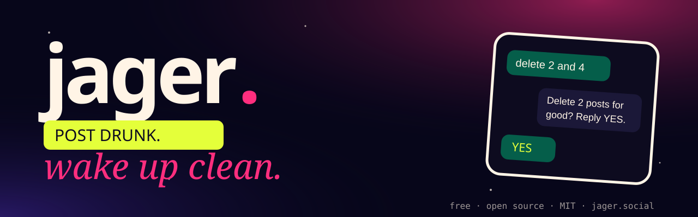
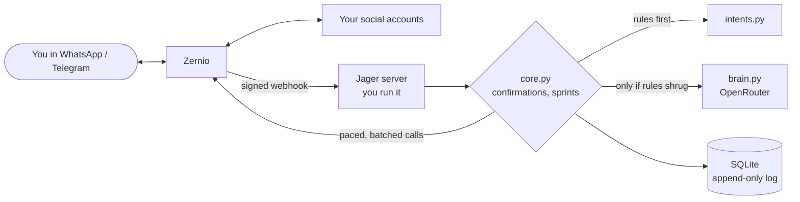

<p align="center">
  
</p>

<p align="center">
  <a href="LICENSE"></a>
  
  
  
</p>

<h3 align="center">A free, open-source buddy in your WhatsApp or Telegram that tells you what you posted,<br>deals with your public comments and cleans up after your 2 AM self.</h3>

<p align="center">
  <a href="https://jager.social">Website</a> ·
  <a href="docs/INSTALL.md">Install</a> ·
  <a href="docs/UPDATE.md">Update</a> ·
  <a href="docs/LEARN.md">Learn how it works</a> ·
  <a href="docs/CAPABILITIES.md">Networks</a> ·
  <a href="docs/PROMPTS.md">Build it with your agents</a>
</p>

> **Jager** is pronounced "Ya-guerr", and yes, it is a pun on the drink. 56 herbs, one stag, zero regrets (until Monday).
> **Launching on Product Hunt on Thursday 3 December 2026.** Come say hi.

---

## What he does

You connect your accounts and a chat app through [Zernio](https://zernio.com). Jager lives in that chat and talks to you like a (slightly judgmental) friend:

```text
you   > what did I post this week?
jager > Here's what you posted in the last 7 days:
        1. [X] pineapple on pizza is a personality test and I failed on purpose (Fri 15:02)
        2. [LinkedIn] Thrilled to announce I am in a kebab shop and have never been more aligned. (Thu 14:02)
        3. [Instagram] my dog in a tiny hat. nothing to add. (Wed 16:02) [no delete]
        ...
you   > delete 1 and 2
jager > Delete 2 post(s) (1, 2) for good? Reply YES to confirm. Anything else cancels.
you   > yes
jager > Done. 2 post(s) deleted for good. 3 left in the list.
```

| | |
|---|---|
| **Recap** | "What did I post this week?" A numbered list across all your networks. |
| **Delete, with manners** | "delete 2 and 4", "delete all". Always a YES first. Always logged. |
| **Timers** | "delete everything I post tonight, an hour after I post it." The night shift. |
| **Comment sprints** | Comments served one at a time: send a draft, edit, hide, delete, skip. Questions first, spam last. |
| **Weekly reminder** | Sunday, your timezone, quiet hours respected: "here is your week, want a sprint?" |
| **Honest about limits** | Instagram does not let apps delete posts. Jager says so instead of failing at 2 AM. |
| **English and French** | Add a language by copying one column. |

## Try him in 10 seconds (no keys, no risk)

```bash
pip install git+https://github.com/paulfxyz/jager
jager demo
```

That talks to a fake Zernio that obeys the same rules as the real one. Type `help`. Type `jager bomb`. There are more easter eggs. We are not telling you where.

## Run him for real

```bash
git clone https://github.com/paulfxyz/jager && cd jager
cp .env.example .env            # three keys, that's the whole product
docker compose up -d
docker compose exec jager jager doctor
```

Full walkthrough with Telegram and WhatsApp, tunnels and the dry-run-to-live switch: **[docs/INSTALL.md](docs/INSTALL.md)**.

## Use him as a library

```python
from jager import Jager

jager = Jager.from_env()          # reads ZERNIO_API_KEY, OPENROUTER_API_KEY, ...
print(jager.weekly_recap())       # the Sunday message, as text
jager.sprint("comments")          # start a comment sprint
jager.handle("delete 2 and 4")    # everything the owner can type also works from code
```

## Build him with your agents

Every part of Jager (app, library, website) can be rebuilt from Markdown prompts in [`prompts/`](prompts/). Paste them into Claude Code, Codex, Perplexity Computer or any agent. See **[docs/PROMPTS.md](docs/PROMPTS.md)**.

## The three keys

| Key | What for | Required |
|---|---|:-:|
| **Zernio** | Connects your social accounts and your WhatsApp number or Telegram bot | yes |
| **OpenRouter** | The brain: understands odd messages, drafts replies. Capped at $0.50/day by default | no, rules work without it |
| **Runware** | Reserved for image jobs (alt text, image checks) | no |

You pay your providers directly for what you use. Jager costs nothing. See [docs/COSTS.md](docs/COSTS.md).

## How he works



New to the codebase? **[docs/LEARN.md](docs/LEARN.md)** is a guided tour: read the files in order and you will understand webhooks, HMAC signatures, retries, idempotency and prompt-injection defence by the end. It is funnier than it sounds.

## Safe by design (the geek section)

- **Dry run is the default.** Jager pretends until you tell him to stop pretending.
- **YES or nothing.** Every delete needs an explicit confirmation from the owner, within 10 minutes. Anything else cancels.
- **Only the owner.** Strangers are logged and ignored. No owner configured means nobody gets in (fail closed).
- **Signed webhooks.** HMAC-SHA256, constant-time compare, 1 MiB cap, dedupe by event id, 30 messages/min rate limit.
- **Comments are untrusted data.** They go to the model inside a cage, the model cannot act, and an AI answer can never produce a YES.
- **Append-only log.** SQLite triggers refuse edits and deletes of the action log.
- **Hardened container.** Non-root, read-only filesystem, no capabilities, loopback-only port.

Details and threat model: **[docs/SAFETY.md](docs/SAFETY.md)** and [SECURITY.md](SECURITY.md).

## Repository map

```text
src/jager/      the app (every file is commented like a tutorial)
tests/          82 offline tests, under a second
site/           the jager.social website (static, EN + FR)
docs/           INSTALL, UPDATE, LEARN, SAFETY, CAPABILITIES, CONFIGURATION, COSTS, TROUBLESHOOTING...
prompts/        Markdown prompts to rebuild everything with your own agents
examples/       three small runnable scripts
```

## Contributing

Add a sprint, fix a bug, translate a joke. Read [CONTRIBUTING.md](CONTRIBUTING.md). Translations are the easiest first pull request: copy one column in `src/jager/i18n.py`, and the tests tell you if you forgot a key.

## License

[MIT](LICENSE), copyright Enki Ltd. Use it, change it, sell it, host it for friends. Jager is a sister project of [Iris](https://iris.online) and [Digital Spot](https://digital.spot). Not affiliated with Jägermeister, Zernio, WhatsApp, Telegram or Meta. Please drink and post responsibly.
