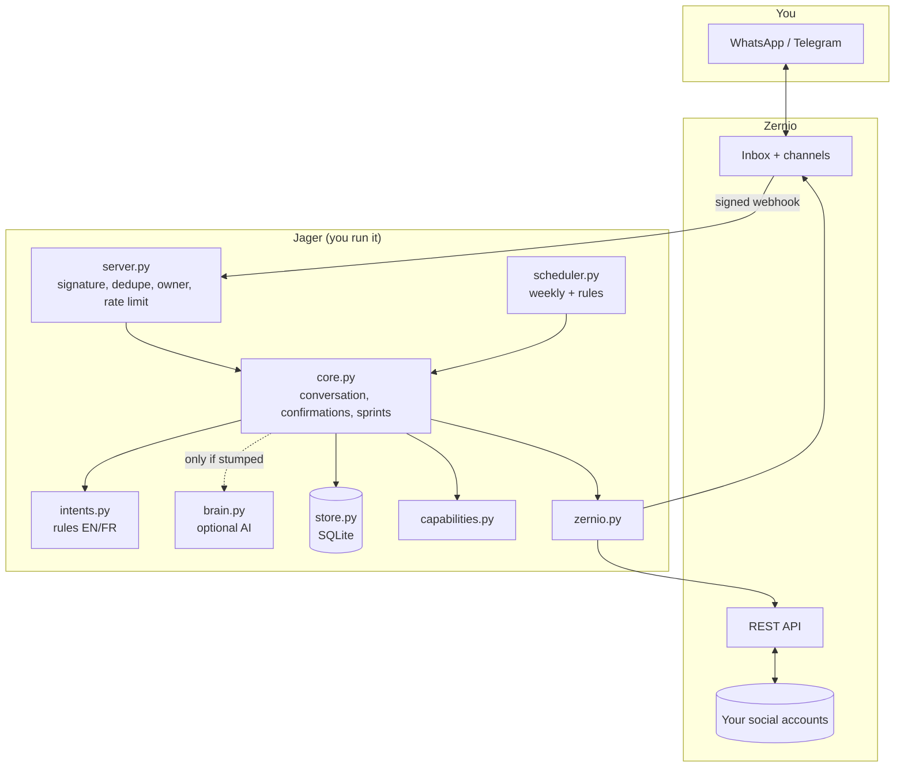

# Architecture

## Request lifecycle

1. You message Jager. Zernio receives it and POSTs `message.received` to `/webhooks/zernio`.
2. `server.py` checks size, verifies the HMAC signature, parses JSON, dedupes the event id, and answers `200` immediately.
3. In the background: owner check, rate limit, remember where to reply (`chat` in the store).
4. `core.handle(text)`: open confirmation? YES executes, anything else cancels. Otherwise parse the intent (rules, then AI if stumped) and dispatch.
5. Destructive intents go through the capability matrix, create a pending confirmation, and ask. Nothing happens yet.
6. On YES: `_execute` performs exactly the stored payload, paced and batched, logging every step.
7. Replies go back through `send_message` (max 4 parts, WhatsApp-friendly).

## Design decisions

| Decision | Why |
|---|---|
| Python, FastAPI, SQLite, 3 dependencies | One `pip install`, one file of state, little to audit |
| Sync core, threads | A single-owner buddy handles a few messages a day. Simple beats async here |
| Rules before AI | Cheaper, faster, safer, works offline |
| State in SQLite, not memory | Restart-proof sprints and confirmations |
| Capability matrix as data | One source of truth for chat, docs and website |
| `SocialAPI` protocol + `MockZernio` | Tests and demo run offline; swapping the backend is one class |
| Loopback-only port | Make the safe deployment the default one |
